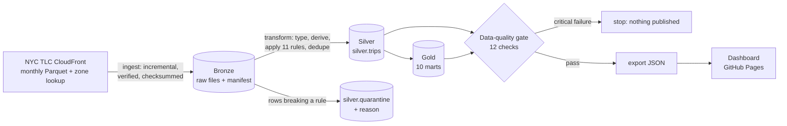

# NYC Taxi Analytics

**An end-to-end data project on 20 million real NYC taxi trips**: a medallion pipeline in DuckDB (incremental ingestion, cleaning with quarantine, a data-quality gate, business marts) and an analysis dashboard built on top of it.

**▶ Dashboard:** https://sudhaseeli.github.io/nyc-taxi-analytics/

| | |
|---|---|
| **Data** | Every NYC yellow-taxi trip, Jan–Jun 2024 · official [NYC TLC trip records](https://www.nyc.gov/site/tlc/about/tlc-trip-record-data.page) · 20.3 M raw rows, 6 Parquet files (≈340 MB) |
| **Engineering** | Bronze → silver → gold in DuckDB · idempotent monthly loads · 11 cleaning rules with a quarantine table · 12 data-quality checks that block publishing · row-level reconciliation · pytest + GitHub Actions |
| **Analytics** | Demand and revenue trends · hour × weekday demand and speed · borough and airport economics · tipping behaviour · busiest routes |
| **Runtime** | Full pipeline (download + transform + checks + export) in **≈35 s** on a laptop |

## Key findings (Jan–Jun 2024)

- **19.55 M clean trips, $549.8 M in fares and charges.** Average fare $19.32; card riders tip **25.0%** of the fare on average.
- **Demand grew 26% from January to May** (2.86 M → 3.59 M trips) and **revenue 34%**. The average fare rose from $18.46 to $20.16 as trips got slower: 15.0 → 17.5 minutes for only ~4% more distance.
- **Airports punch far above their weight.** Trips leaving JFK are 4.4% of all trips but about **13% of revenue** ($82.73 average). Queens is 8.7% of pickups but **22.7% of revenue**.
- **Thursday 6 pm is peak demand** (≈9,300 trips/hour). Traffic is slowest Thursday 3 pm (8.4 mph) and fastest Sunday 6 am (22.1 mph), **2.6× quicker**.
- **Short rides tip proportionally more**: 31% of the fare under 1 mile vs 18% over 20 miles, consistent with riders using preset tip buttons or rounding up.
- **The busiest route is a 1-mile hop**: Upper East Side South → North, 137,836 trips at $8.87 average. Short Upper East Side ↔ Midtown trips dominate the top 10.
- **3.8% of raw rows fail validation.** The largest groups are negative charges (1.37%, refunds and voids), sub-minute trips (1.13%) and zero-distance trips (1.0%).

## Architecture



### Layers

| Layer | Where | What happens |
|---|---|---|
| **Bronze** | `data/bronze/` | Monthly files downloaded exactly as published. Each is written to a temp file, verified as readable Parquet with rows, then atomically renamed. `_manifest.json` records URL, bytes, rows, SHA-256 and load time, so re-runs skip months already loaded. |
| **Silver** | `silver.trips`, `silver.quarantine`, `silver.zones` | Columns typed and renamed; derived fields (duration, mph, tip %, hour, weekday). Each row is checked against 11 rules in priority order; failures go to quarantine **with the rule they broke**. Exact duplicates are removed. Loads are per month and idempotent (delete + insert in one transaction). |
| **Gold** | `gold.*` | Business marts rebuilt from silver: `monthly`, `daily`, `hourly_heatmap`, `zone_stats`, `top_routes`, `payment`, `airports`, `borough_monthly`, `tip_by_distance`, `quarantine_summary`. |
| **Meta** | `meta.load_stats` | Per month: raw rows, clean rows, quarantined rows, duplicates, load time. |

### Cleaning rules (silver)

| Rule | Condition | Rows (Jan–Jun) |
|---|---|---|
| `negative_amount` | fare or total < 0 (refunds, voids) | 278,043 |
| `duration_under_1min` | trip under 1 minute | 229,403 |
| `zero_distance` | distance ≤ 0 | 202,544 |
| `fare_below_minimum` | fare below the $3 minimum | 49,072 |
| `duration_over_4h` | trip over 4 hours | 11,952 |
| `non_positive_duration` | drop-off at or before pickup | 6,177 |
| `distance_over_100mi` | distance > 100 miles | 697 |
| `speed_over_80mph` | average speed > 80 mph | 622 |
| `pickup_outside_month` | pickup timestamp outside the file's month | 149 |
| `passengers_over_8`, `total_over_1000`, `missing_timestamp` | rare data-entry errors | 12 |

### Data-quality gate

Critical checks fail the run (exit code 1) and **nothing is exported**. Warnings are reported.

| Check | Severity |
|---|---|
| Silver is not empty | critical |
| Row reconciliation: raw = clean + quarantined + duplicates, for every month | critical |
| No null timestamps or zone IDs | critical |
| Every clean trip lasts 1–240 minutes | critical |
| Fares ≥ $3 and totals between $0 and $1,000 | critical |
| No duplicate trips | critical |
| Every zone ID exists in the zone lookup (referential integrity) | critical |
| Gold monthly totals reconcile exactly with silver | critical |
| Quarantine rate under 5% per month | warn |
| Every calendar day has trips (completeness) | warn |
| Unknown-zone pickups under 3% | warn |
| Average card tip between 10% and 30% (plausibility) | warn |

The latest run passed all 12 checks. Reports are written to `data/reports/dq_report.{json,md}`.

## Run it

```bash
git clone https://github.com/sudhaseeli/nyc-taxi-analytics && cd nyc-taxi-analytics
python -m venv .venv && source .venv/bin/activate     # Windows: .venv\Scripts\activate
pip install -e ".[dev]"

taxi run                                  # ingest → transform → quality gate → export
taxi run --months 2024-07 2024-08         # add months incrementally
taxi quality                              # re-run just the checks
python -m http.server -d docs 8000        # open http://localhost:8000
```

Query the warehouse directly:

```bash
duckdb data/warehouse.duckdb "SELECT * FROM gold.monthly"
```

## Tests

```bash
pytest -q
```

The tests build a tiny synthetic month with known good rows, an exact duplicate and one row breaking each cleaning rule, so they run offline in about 4 seconds. They check that:

- clean rows reach silver and every bad row is quarantined with the expected reason
- re-running a month is idempotent
- derived columns are correct (duration, mph, card-only tip %, hour, weekday)
- gold marts aggregate correctly (revenue, airport directions, top route)
- the quality gate passes on clean data and **catches** injected duplicates and bad durations
- the dashboard export contains every mart plus the DQ report

CI runs the same tests on Python 3.10, 3.12 and 3.13.

## Project layout

```text
taxi/
  config.py      paths, source URLs, airport and payment lookups
  ingest.py      bronze: incremental, verified, checksummed downloads + manifest
  transform.py   silver (rules, quarantine, dedupe, idempotent loads) and gold marts
  quality.py     12-check data-quality gate with JSON/Markdown reports
  export.py      gold → docs/data/dashboard.json
  cli.py         taxi run | ingest | transform | quality | export
docs/            dashboard (GitHub Pages) + exported data
tests/           synthetic fixture + 7 pipeline tests
```

## Next steps

- Orchestrate with Airflow or Dagster on a monthly schedule
- Move SQL models to dbt, with dbt tests mirroring the quality gate
- Add green taxis and for-hire vehicles (Uber/Lyft) for market-share analysis
- Join NOAA weather to quantify the rain and snow effect on demand
- Run on S3 + Athena with Terraform, reusing the same SQL

## License

MIT. Trip data © NYC Taxi & Limousine Commission, used under its open-data terms.
